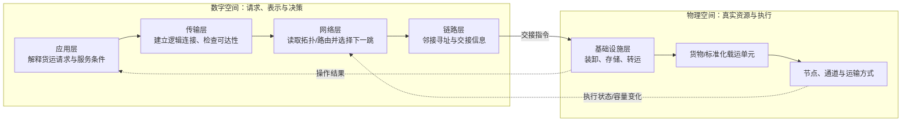
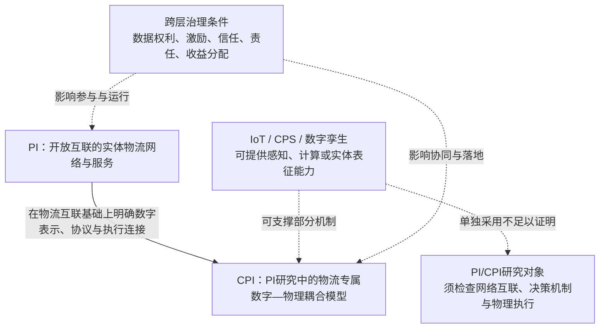
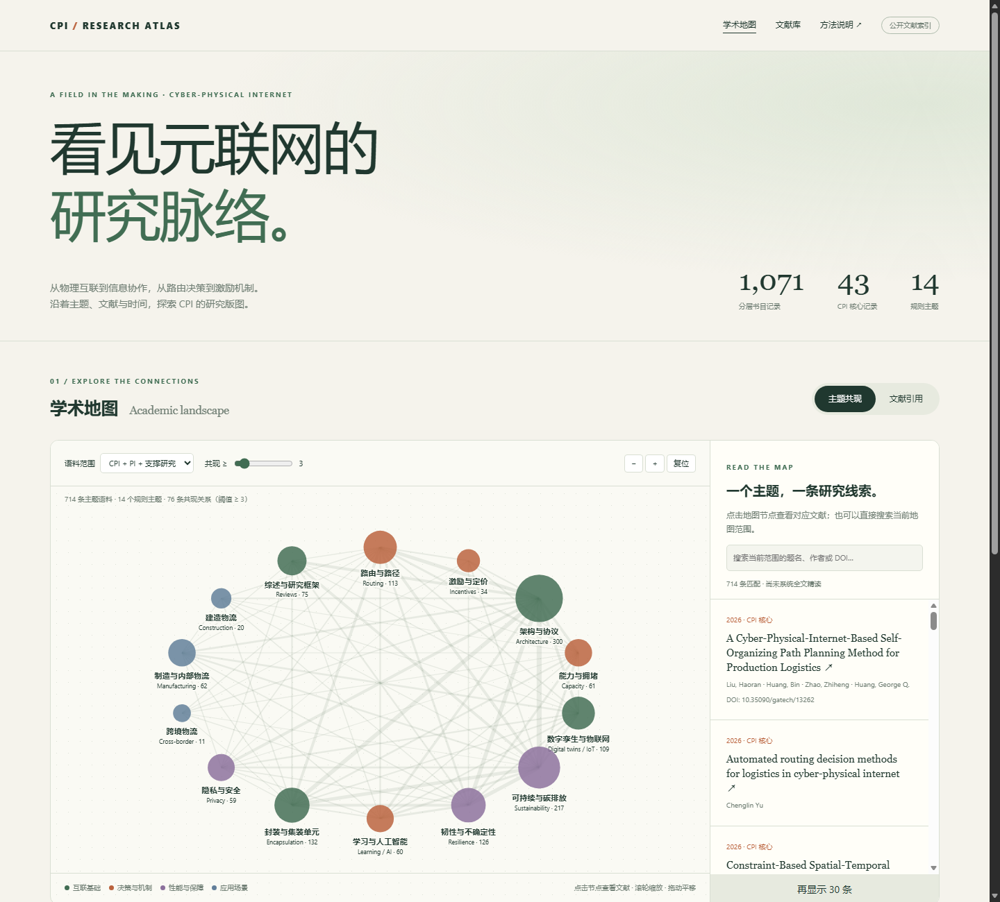

# CPI Research Dataset · 元联网研究文献库

**公开研究索引 · Cyber-Physical Internet · 文献、数据线索与证据来源**

面向 CPI 专题研究的可追溯文献数据集。出版日期截止 **2026-10-21**，构建于 **2026-10-22**。当前保留 **1,071 条分层记录**，其中 **43 条 CPI 核心记录**；这不是独立研究或同行评审论文数量，也不是穷尽性系统综述。

## 理论框架：从 PI 到 CPI

本节为本库的理论与证据框架，不是新的正式定义。文献中的 PI/CPI 中文译法和模型边界并不完全一致；本库以原文研究对象、机制和证据分类，不仅按缩写或中文词语归类。

### PI 是开放物流网络的设计范式，不是已建成的全球网络

Physical Internet（PI）借数字互联网的互联思想，提出将货物、模块化载运单元、物流节点、运输通道和服务提供者连接为跨组织物流网络。其理论对象不是“给货物装传感器”本身，而是物流服务如何通过封装、接口、流程/协议和运营协作实现互联。[Montreuil（2011）](https://doi.org/10.1007/s12159-011-0045-x)提出愿景与系统特征；[Pan 等（2017）](https://doi.org/10.1080/00207543.2017.1302620)梳理互联物流服务研究；它们提供的是研究范式与实现方向，不能单独证明全球开放网络已经形成或预期收益已经实现。

数字互联网类比可以启发模块化、寻址、路由、层间接口与服务互联，却不是可以逐层照搬的工程蓝图。货物有异质尺寸、价值与处理要求，不能任意复制或无成本重传；运输消耗真实容量，受班次、时窗、装卸、转运、库存、拥堵和参与者约束；时间、成本与排放也会随路径和货物而变。[Dong 与 Franklin（2021）](https://doi.org/10.1111/jbl.12253)据此将 PI 的问题拆为**可达性**（是否存在满足物理与服务条件的可行路径）和**优化性**（在可行方案中怎样权衡成本、时间、排放等指标）。图论上连通不代表实际服务可行，求得某个目标的最优解也不代表商业参与方会接受该方案。

### CPI 把数字表示、网络决策和物理执行放入同一问题

Cyber-Physical Internet（CPI）是 PI 研究中进一步明确数字空间与实体物流耦合的一条理论路线。[Wu 等（2025）](https://doi.org/10.1016/j.tre.2025.104051)回顾 PI 文献后指出，数字化对 PI 的作用机制仍不清楚，并提出 CPI 基础模型。其逻辑是：现实对象和状态具有数字表征；节点通过协议和地址交换请求/状态；网络层安排货运单元及下一跳；链路和基础设施层把数字决策落实为装卸、转运与运输；执行状态再更新数字侧的网络认知。以下流程图是依据论文文字综合绘制的**概念示意**，不是论文原图，也不声称已有系统完整实现该闭环。



Wu 等提出的五层自上而下为 Application、Transport、Network、Link、Infrastructure。论文 Table 1 定义 CPI 构件，Figure 5 展示层职责，Figure 6 描述相邻节点间的发送与接收流程；构件包括物理/数字实体、CPI 运输单元（CPI-PSU）、通道、协议、PIP 地址、CPI-MAC 地址、路由表和请求。模型中，应用层解释请求并匹配货运单元；传输层建立数字侧逻辑连接/检查可达性；网络层根据拓扑和路由信息作下一跳决策；链路层处理相邻节点的地址与交接；基础设施层执行物理操作。[论文全文与图表](https://ira.lib.polyu.edu.hk/bitstream/10397/111680/1/1-s2.0-S1366554525000924-main.pdf)

这五层是 **Wu 等提出的基础架构**，不是行业已批准或跨研究团队统一采用的标准，也不应与 OSI/TCP-IP 层逐一等同。层间接口能帮助分解功能，却不能自动提供真实运力、时效保证、安全性或商业互操作认证；这些性质必须在具体协议、模型假设和运营证据中分别验证。其他 CPI 研究可能采用不同层名或只研究局部机制，应按原文记录，不能仅凭“CPI”标签假设兼容。[Wu 等（2025）](https://doi.org/10.1016/j.tre.2025.104051)

### 相邻技术不是同义概念，治理也不是额外一层

IoT、CPS 和数字孪生的术语在跨领域文献中有重叠，不能假设它们存在普遍且互斥的定义。[NIST 对 CPS/IoT 的综述](https://doi.org/10.6028/NIST.SP.1900-202)也指出定义边界并无一致区分指标。对本库而言，判别重点是研究机制：PI 关注开放物流网络和互联服务；CPI 文献进一步把数字表示、信息交换/协议、网络决策与物理物流连接起来；IoT可提供感知和连接，数字孪生可表征或模拟实体，但单独出现传感器、追踪或数字孪生并不足以构成 PI/CPI 研究。数字侧信息是否实时更新、是否跨组织互操作、是否改变物流决策、是否影响真实执行，是精读时应逐项查证的问题。[NIST 数字孪生报告](https://doi.org/10.6028/NIST.IR.8356)

下图是本库用于编目和筛选的**概念综合**，不是领域标准本体：



协作、激励、数据权利、隐私、信任、责任和收益分配是跨层治理条件，而不是 Wu 等五层模型中另一个已定义的技术层。开放网络的技术可行性与参与方的商业可行性是两个问题：需要记录谁拥有资产与数据、谁能访问/披露信息、服务如何定价、发生延误或损坏时由谁承担责任，以及参与者是否有加入和共享容量的激励。CPI综述将数字化、网络配置与服务、协作机制列作研究路线；这表示待研究的问题，不代表解决方案已经成熟。[Wu 等（2025）](https://doi.org/10.1016/j.tre.2025.104051)

### 把架构主张和绩效证据分开编码

PI 的效率、韧性和可持续性是目标或待检验结果，不是概念定义。现有证据类型跨越概念愿景、数学/协议模型、仿真、原型、有限现场测试和常态化运营，不能互相替代。比如，PI运输协议研究使用法国快消品货流进行仿真，说明特定情景下可计算潜在效果，但并非长期现场因果评估。[Sarraj 等（2014）](https://doi.org/10.1080/00207543.2013.865853)；PILL 项目页面报告安特卫普走廊一次为期两周、涉及十个货代/承运人/码头运营者的 Living Lab 测试，属于有限范围现场验证，不能据此推断全球规模化效益。[PILL 项目说明](https://www.imec.be/nl/vlaamse-innovatiemotor/samenwerking/vlaamse-onderzoeksprogrammas/physical-internet-living-labs)

同理，CPI 论文使用真实医药物流数据或大湾区案例开展仿真/数值实验，能提高问题设定的情境相关性，但不等于 CPI 平台已在现实网络中运行。[CPI-LI² 研究](https://doi.org/10.1016/j.aei.2024.102551)；[建筑模块调度研究](https://doi.org/10.1109/TITS.2025.3581569)。评价“改善”时应核对比较基线、系统边界、需求和容量、服务质量、指标口径、时间范围及不确定性；不同研究的成本/排放结果不能只按百分比横向合并。

| 本库证据标签 | 可支持的判断 | 不能单独支持的判断 |
|---|---|---|
| 概念/架构提案 | 概念、构件、层次和待检验机制被提出 | 已建成、互操作或有效 |
| 形式模型/算法 | 特定假设下的性质或可计算决策 | 假设在现实中成立 |
| 合成或校准仿真 | 模型在指定数据/场景中的计算表现 | 真实运营中的因果效果 |
| 原型/实验室 | 组件可运行或接口可演示 | 多组织、跨区域长期采用 |
| Living Lab/有限现场试点 | 特定地点、参与者和期限内的可行性 | 普遍适用或规模化净收益 |
| 持续运营/比较评估 | 明确边界内的实际表现；有合适对照时可评估效果 | 未覆盖地区、行业或网络的普遍结论 |

据此，本库的工作性纳入规则是：**直接 CPI 研究必须以物流/供应网络为对象，并明确提出或分析数字表示/信息机制与实体运输、网络服务、配置或执行之间的耦合。** 仅谈 IoT、CPS、数字孪生或“智慧物流”时，除非文本显示这一网络与物理执行机制，否则归为支撑技术或邻接背景；PI 网络研究若没有明确的数字—物理耦合，则保留在 PI 基础层。对每篇核心文献记录原文定义、研究问题、物理约束、数字机制、参与方/治理、数据来源、评估方式和部署状态。该规则是本库的编目框架，不是学界共识。更多网页线索与限制见[来源梳理](docs/web-source-synthesis.zh-CN.md)，筛选与覆盖边界见[方法说明](docs/methodology.zh-CN.md)。

## 从这里开始

**[项目声明与文献使用说明](DISCLAIMER.md)** · [权利边界](RIGHTS.md) · [PDF 本地分析与写作](docs/pdf-workflow.zh-CN.md)。公开内容不包含论文原文、提取全文或第三方原始摘要；科研用途本身不替代具体授权条件。

**在线访问：[CPI 研究网站与学术地图](https://cpi-research-atlas.shentonyan.chatgpt.site)**。网站和 GitHub 仓库公开；下载原文和原始摘要缓存保留在本地或私有备份中。GitHub 文件页不会执行 HTML，因此请使用这个网站入口。



地图包含主题共现、局部文献引用、研究时间线，可选择节点、检索文献、筛选年份与缩放。离线打开 `map.html` 也能使用。关系依据、范围与局限见 [学术地图方法](docs/academic-map.zh-CN.md)。

- **阅读**：[CPI 核心文献索引](docs/core-reading-index.zh-CN.md) · [研究路线与精读问题](docs/research-guide.zh-CN.md)
- **导入 Zotero**：[RIS 书目](data/processed/library.ris) · [BibTeX](data/processed/library.bib)
- **分析**：[全部 CSV](data/processed/corpus.csv) · [核心 CSV](data/processed/core_cpi.csv) · [JSONL](data/processed/corpus.jsonl) · [SQLite](data/processed/library.sqlite)
- **开始精读**：[研究提取表](data/processed/research_extraction_template.csv)
- **核验**：[方法与覆盖缺口](docs/methodology.zh-CN.md) · [字段字典](docs/data-dictionary.md) · [实际统计](data/processed/summary.json) · [PI/CPI网页线索与编码框架](docs/web-source-synthesis.zh-CN.md) · [外部来源台账](data/external_source_register.json)
- **浏览**：克隆或下载仓库后，双击根目录 `index.html`。离线支持题名、作者、DOI、关键词检索，按范围与年份筛选；不启用公开 Pages。

## 当前覆盖

| 范围 | 记录数 |
|---|---:|
| CPI 核心研究 | 43 |
| CPI 关联语境 | 5 |
| Physical Internet 基础 | 548 |
| 支撑技术与方法 | 118 |
| 种子参考背景 | 334 |
| 同名术语与历史 | 12 |
| 研究项目与动态 | 7 |
| 资源与数据入口 | 4 |

候选去重后 **5,067 条**，规则排除 **3,996 条**，**990 条含 DOI**。公开版本不转载第三方原始摘要，原检索中可取得摘要的记录用 `source_abstract_available` 标记，阅读请访问来源链接。排除记录保留于 [筛选决定](data/processed/screening_decisions.csv)，版本候选见 [可能版本](data/processed/possible_versions.json)。书目数量不等于独立研究数量。

来源包括 Crossref、DataCite、HAL、arXiv，以及大学机构库、出版社、会议和资助方页面。查询设有分页上限；没有 Scopus、WoS、CNKI 订阅检索。DBLP 遭遇限流。公开版本保留查询日志、来源、书目与筛选结果；完整原始响应保留在私有/本地研究输入中，详见 [公开版本说明](docs/public-release.md)。不把访问失败当成零篇结果。

## 证据状态

已归档并验证校验值的原始 PDF：**0**。本轮机构库全文下载受超时、TLS 或访问限制影响，详见 [全文清单](data/fulltext_manifest.json)。**没有把书目解析或机器抽取当成完成全文精读**；精读提取字段保留为空。

已发现 HKU CPI 配套数据的概念与版本 DOI，但 Figshare 明确标注文件禁运，因此仅收录公开元数据，没有获取禁运文件。记录类型、同行评审状态、全文状态和数据可得性分开管理。

## 本地重建与检索

需要 Python 3.10+。从仓库根目录运行：

```text
python -m pip install -r requirements.txt
python scripts/build_map.py
python scripts/finalize.py
python scripts/validate_public.py
python scripts/search.py "routing AND carbon" --tier core_cpi
```

已发布书目与地图可直接使用。完整重跑筛选需要本地原始输入；需要扩展检索时，运行采集脚本后再执行 `build.py`。原始缓存和下载的 PDF 写入忽略目录，`build.py` 在公开导出前移除原始摘要。不要直接上传采集目录；公开包使用 `scripts/package_public.py`。

## 研究纪律与私有性

标签由规则产生，不是已核验的方法分类。收录不表示支持论文结论；新闻、资助愿景、数值模拟、实验室演示和真实运营证据需要分别评价。术语历史不等于物流 CPI 直接研究。没有检出某个主题不证明研究空白。

仓库与网站公开。PDF 原文、提取全文和原始摘要缓存不随公开版本发布。公开不等于对第三方材料统一授权，详见 [项目声明](DISCLAIMER.md)、[权利边界](RIGHTS.md)及[本地 PDF 工作方式](docs/pdf-workflow.zh-CN.md)。

用户提供的行业网页和百科入口作为外部线索单独登记，不计入文献数量或学术证据。可读取页面的概念归纳、不可访问页面的状态，以及后续精读编码建议见 [PI/CPI网页线索与编码框架](docs/web-source-synthesis.zh-CN.md)。
